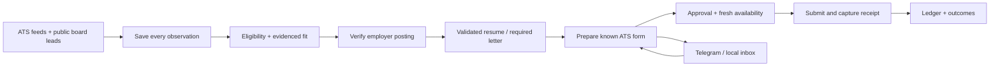

# Jobhunt

[](https://github.com/JenishPatel20/jobhunt/actions/workflows/tests.yml)

A local Python workflow for discovering jobs, verifying availability, evaluating fit,
preparing application documents, applying with human oversight, and tracking outcomes.
Built by **Jenish Patel**.

SQLite holds the private ledger. The workflow runs on your Mac while awake and keeps
its progress through sleep/restarts. There are no hosting or paid automation dependencies.
Model work uses supported ChatGPT subscription authentication, subject to your account's
limits. It pauses on unavailable access; API billing and paid fallbacks are disabled.



## What works and what needs review

- Greenhouse, Lever, Ashby, and Workday discovery adapters; optional public-board discovery via JobSpy.
- Every returned observation is recorded before exclusion, including stale or malformed listings.
- Stable source/requisition identities, separate source links, description snapshots, and possible-duplicate review.
- Open/closed/uncertain checks against Greenhouse, Lever, and Ashby employer endpoints.
- Eligibility evidence stays separate from technical fit. Sponsorship silence remains unknown;
  historical employer sponsorship prioritizes matches without raising a weak fit score.
- Full-time and internship roles share the fit queue. Compensation metadata keeps its original units.
- Versioned resumes and required cover letters, source ownership checks, PDF text checks,
  and horizontal-overflow detection. Upload is blocked if required documents fail validation.
- A deterministic **Greenhouse classic form** adapter, with explicit approval and receipt evidence.
  Other form layouts pause for manual handling; this does not claim universal ATS automation.
- Durable Telegram alerts/replies, scoped answers, human browser takeover, and submission reconciliation.
- Complete local CSV/JSON exports and optional read-only Gmail outcome tracking.

Workday discovery currently fetches a bounded page and cannot establish closure. Public-board
adapters can be blocked or unavailable. Unsupported employer links require human verification
or a supported employer URL. Live ATS compatibility, subscription access, and notification
credentials still require your own reviewed setup; local fixture tests do not establish them.

## Setup

Python 3.11+ on macOS/Linux is required. Scheduling uses macOS launchd.

```bash
python3 -m venv .venv
source .venv/bin/activate
python -m pip install -e '.[dev,pdf]'
playwright install chromium
jobhunt init
```

`init` creates missing local configuration and `.env` files, preserving existing files.
Examples describe a **fictional candidate**. Replace all candidate facts and answers in
`config/profile.yaml` and `config/answer_bank.yaml`. Set `example_profile: false` only after
replacing the fictional content. Add reviewed employer boards to `config/companies.yaml`.

Provide your own confirmed work-authorization/start-date answers and their review window
(`answers_confirmed_on`, `answers_valid_until`). Missing or expired answers pause required
form questions. The workflow never derives work authorization from a student status or graduation date.

Install Codex CLI and sign in with your existing ChatGPT subscription:

```bash
npm install -g @openai/codex
codex login
jobhunt preflight
jobhunt llm-doctor
jobhunt profile-confirm
```

The provider refuses API-key authentication, removes API-key environment overrides from its
child process, uses isolated read-only runs with shell/web tools disabled, and has no paid
fallback. `llm-doctor` makes one small explicit model request without candidate/job data.
Included API credits are not wired up because the application cannot enforce a credits-only
billing boundary. Check your subscription usage settings and disable any account-level
automatic credit purchases; this project never purchases credits.

Legacy Gemini CLI and unverified ApplyPilot submission are disabled. Existing databases are
migrated on opening with a `*.before-v2.db` backup. Existing job IDs and application records
are retained; observations lost before this version cannot be reconstructed.

## Daily operation

```bash
jobhunt discover
jobhunt filter --limit 30
jobhunt tailor --limit 10
jobhunt apply --dry-run --limit 10
jobhunt inbox
jobhunt status
jobhunt export
```

The live cap defaults to 10 applications per day. It is a ceiling, not a requirement to fill
with weak matches. Daily scoring is bounded to 30 jobs by default, reserving model-call
capacity for document preparation. Cover letters are generated only when marked required; the form adapter
can detect that requirement and return a job to document preparation.

Use `jobhunt job JOB_ID` to inspect a job's sources, observations, decisions, documents,
attempts, and human requests. `jobhunt export` writes **all jobs** to `reports/jobs.csv` and
the full private ledger to `reports/ledger.json`, including rejected/closed jobs.

See the [operator guide](docs/operations.md) for Telegram setup, exact approvals, duplicate
review, browser takeover, retrying documents, linking employer URLs, and live promotion.

## Live submission gates

Live operation requires successful dry runs (20 by default), explicit `jobhunt go-live`,
a reviewed unchanged profile, valid artifact hashes, and current employer availability.
Initially every application also needs your approval of its prepared form/documents.

After at least three distinct individually approved, confirmed live trials, you may explicitly
promote `greenhouse-classic-v1`. Promotion covers previously validated form shapes only;
changed forms/questions and unapproved certifications still pause.

```bash
jobhunt go-live
jobhunt review-application JOB_ID
# Review the local form screenshot and documents, then approve its request.
jobhunt approve REQUEST_ID
jobhunt apply --live --limit 1
# Only after reviewing the required successful trials:
jobhunt workflow-enable greenhouse-classic-v1 --evidence 'Reviewed the form mappings and employer receipts'
jobhunt pause-live
```

A process exit or model response is not proof of submission. Missing receipts or interrupted
submission boundaries enter reconciliation. `done` and `retry` require human evidence, preventing
blind repeated submissions. Applications remain in submission totals after interviews/rejections.

## Local data and privacy

Profiles, answers, `.env`, OAuth files, SQLite databases/backups, browser sessions, screenshots,
resumes, and reports remain local and ignored by Git. Back up the ignored `data/` and `out/`
directories yourself; the ledger and browser sessions contain personal information.

Candidate facts and job descriptions are supplied to the configured model for fit/tailoring.
Phone/email/links are omitted from model summaries. Telegram receives job/request summaries
and your replies; the bot accepts commands only from your configured private user/chat.
Gmail integration, when explicitly enabled, reads headers/snippets, not full bodies. LinkedIn
refresh output remains a local draft for manual review and posting.

## Tests

```bash
python -m pytest -q -m 'not browser'
# Local browser/PDF acceptance tests, using only loopback fixture forms:
JOBHUNT_BROWSER_TESTS=1 python -m pytest -q -m browser
```

The browser suite requires the `pdf` extra and Chromium. It covers dry-run request blocking,
approval, receipts, changed forms/consents, required letters, session recovery, availability,
and PDF completeness/overflow. Tests use fictional temporary profiles; external Requests calls
are blocked unless explicitly mocked. See [development](docs/development.md).

For coding agents, read [AGENTS.md](AGENTS.md), [handoff](docs/handoff.md), and relevant folder instructions:

> Read root AGENTS.md, docs/handoff.md, and relevant folder instructions. Consult docs/decisions.md for relevant decisions, then inspect the current code and Git status before making changes.

This repository contains no license grant. See [architecture](docs/architecture.md) and
[decisions](docs/decisions.md) for implementation boundaries and lasting rationale.
