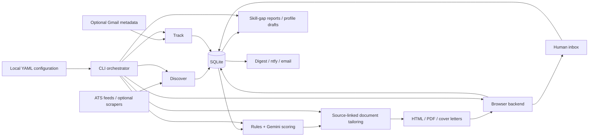

# Architecture

Jobhunt is a local command-line pipeline. SQLite stores jobs, applications, learned answers,
LLM attempts, human requests, and email events. Files hold input configuration and generated documents.

## Configuration and storage

`JOBHUNT_HOME` selects the project home; otherwise the CLI uses the current directory. Settings,
filters, and title rules are tracked YAML. Candidate facts and answers live in ignored local files
copied from `config/examples/`. Credentials are loaded from the home directory's `.env`.

The default database is `data/jobhunt.db`. Tailored documents go into `out/<job-id>/`; refresh drafts
and skill-gap reports go into monthly directories under `drafts/` and `reports/`. All are ignored.

## Processing

Discovery normalizes ATS records and deduplicates jobs by their stored identity. Filtering applies
hard rules before model scoring and sponsor boosts. Thin descriptions require a higher configured
score. Gemini requests have bounded retries, model fallback, request accounting, and a persisted
cooldown. A daily run skips subsequent tailoring/application stages when scoring is unavailable.

Tailoring ties selected bullets to source IDs. Checks reject new numeric values and selected technology
names absent from profile facts, falling back to source wording. These checks do not prove semantic
truth; review generated documents. Playwright is optional for PDF rendering.

The application module checks required profile values, the dry-run gate, explicit live enablement,
and the daily live-submission cap. Browser requests for human help enter the inbox. Interrupted
attempts require reconciliation to avoid blindly repeating a possible submission. A Unix advisory
file lock prevents overlapping mutating CLI runs.

Tracking maps read-only email metadata and snippets to events. Learning aggregates gaps from scored
jobs and writes reports and professional-profile drafts. It does not publish LinkedIn content.

## External boundaries

ATS requests fetch job data. Gemini API calls receive job descriptions and candidate fact summaries;
application payloads go to the Gemini CLI browser backend. ntfy or SMTP can send notifications.
Gmail OAuth is optional. Tests mock these boundaries and cannot establish live service compatibility.
